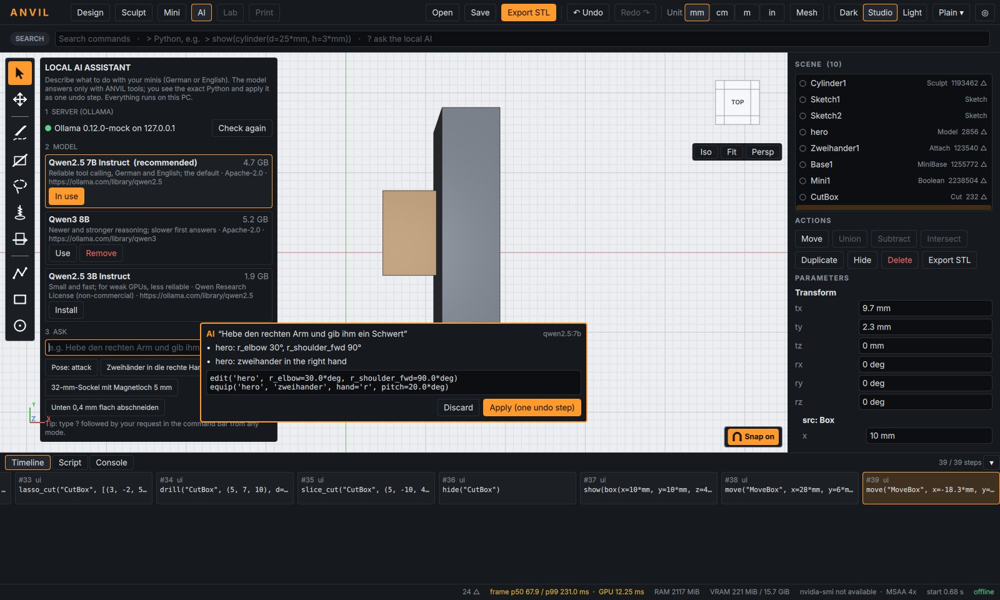

# ANVIL – Lokaler KI-Assistent (Qwen) und verzerrungsfreies Posen

## 1. Einrichten (einmalig)

1. **Ollama installieren**: im Browser ollama.com öffnen, Windows-Installer laden und
   ausführen. Ollama läuft danach im Hintergrund (Symbol in der Taskleiste).
2. In ANVIL oben **AI** wählen. „Ollama … on 127.0.0.1“ mit grünem Punkt = gefunden
   (sonst „Check again“).
3. Unter **MODEL** bei *Qwen2.5 7B Instruct* auf **Install** klicken (4,7 GB; Fortschritt
   wird angezeigt). Danach „In use“.

Datenschutz: ANVIL selbst verbindet sich nur mit 127.0.0.1. Den Download erledigt Ollama;
die Fragen und das Modell bleiben auf dem PC.

## 2. Benutzen

- Im KI-Modus ins Feld **ASK** schreiben – oder in jedem Modus in der Befehlszeile oben
  `?` gefolgt von der Bitte, z. B.
  `? Hebe den rechten Arm, gib ihm einen Zweihänder und mach einen 32-mm-Sockel mit Magnetloch`.
- Der Assistent zeigt unten rechts, **was** er tun würde (Stichpunkte) und das **genaue
  Python**. **Apply** führt es aus – ein Undo-Schritt; **Discard** verwirft.
- Was er nicht darf oder falsch verstanden hat, steht mit ⚠ dabei und wird nicht ausgeführt.

Er kann: Pose-Vorlagen, einzelne Gelenke (Grad), Höhe, Waffe in die Hand, Sockel,
Magnetloch, flacher Boden, Verschieben, Drehen, Verschmelzen, Verformungsoptionen, Ausblenden.

## 3. Verzerrung beim Posen beheben

Im Mini-Modus bei ausgewähltem Mini:
- **Rest: Arms down / As in file** – „As in file“ lässt die Pose der Datei als Nullstellung
  (keine Absenkung der T-Pose-Arme; weniger Verformung bei bereits posierten Modellen).
- **Weights: From file / ANVIL (geodesic)** – berechnet die Gewichte neu, entlang des Volumens
  statt quer durch Lücken. Hilft, wenn Rüstung oder Kleidung beim Posen gezogen wird.
- Separate Teile (Schulterplatten, Platten, Taschen) bewegen sich automatisch **starr** mit
  dem nächstgelegenen Knochen.
- Skript: `pose_distortion("Mini")` misst die Dehnung (p99 der Kantenlängen-Verhältnisse).
