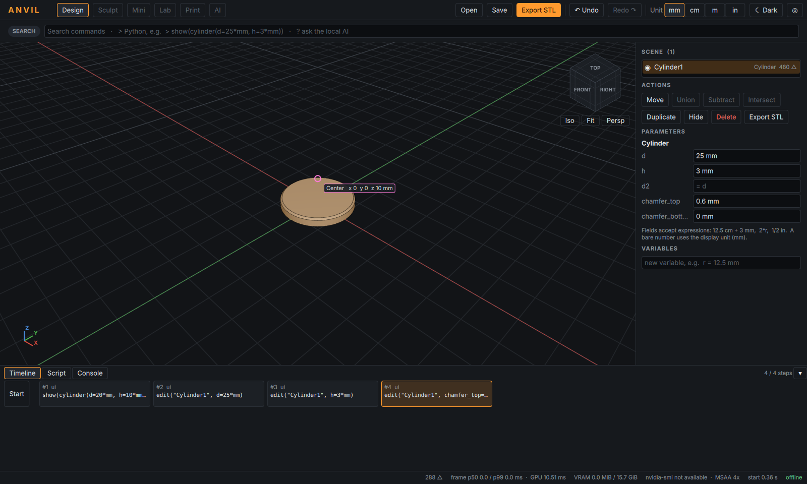
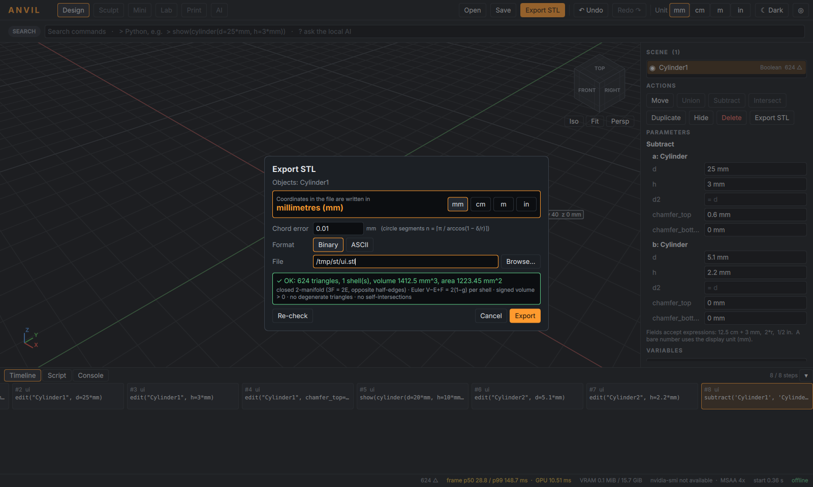

# ANVIL M1 – Kurzanleitung und Demo

## 1. Bauen (Windows 11, einmalig)

```
powershell -ExecutionPolicy Bypass -File scripts\setup-windows.ps1
```
Prüft Visual Studio 2022 Build Tools, CMake, Git und Python 3.11. Danach lädt
es Qt 6.8.3 (LGPL) über aqtinstall nach `.deps\Qt`, aber erst nach Ihrer
Bestätigung; ein Qt-Konto ist nicht nötig.

```
powershell -ExecutionPolicy Bypass -File scripts\build-windows.ps1
```
Das Skript baut, testet (Unit-, Abnahme- und GUI-Selbsttest auf der echten
GPU) und paketiert nach `dist\ANVIL`. Starten mit `dist\ANVIL\ANVIL.exe`. Eine
Installation ist nicht nötig. Der Ordner ist portabel, und zum Update ersetzen
Sie ihn einfach (ADR 0014).

## 2. Bedienung in 60 Sekunden

| Was | Maus | Tastatur (optional) |
|---|---|---|
| Radialmenü | **rechte Maustaste halten, in Richtung ziehen, loslassen** | Leertaste halten |
| Drehen / Verschieben / Zoomen | linke Maustaste ziehen / mittlere ziehen (oder Strg + links) / Mausrad | – |
| Auswählen | Klick im Viewport oder in der Szenenliste (Strg/Shift = hinzufügen) | – |
| Ansicht | ViewCube anklicken (Flächen, Kanten, Ecken = 26 Richtungen), *Iso/Fit/Persp* | – |
| Befehl suchen | in die Befehlszeile tippen, z. B. „cyl“ | Strg + K |
| Python | `> ` voranstellen: `> show(sphere(d=10*mm))` | Tab = Vervollständigen |
| Snapping aus | – | Alt halten |
| Rückgängig | Undo/Redo oben, oder in der Timeline auf einen Schritt klicken | Strg + Z / Strg + Y |

Radialmenü ohne Auswahl: Osten Zylinder, Nordosten Kugel, Norden Quader,
Nordwesten Torus, Westen STL importieren, Südwesten Kegel, Süden Export,
Südosten Ansicht ▸ (Untermenü). Mit Auswahl: Osten Verschieben,
Nordosten Vereinigen, Norden Subtrahieren, Nordwesten Schneiden, Westen
Löschen, Südwesten Ausblenden, Süden Export, Südosten Ansicht ▸. Die
Positionen bleiben fest. Nicht anwendbare Befehle werden ausgegraut, nicht
entfernt. Umbelegen per Drag & Drop über ◎ oben rechts.

Eingabefelder akzeptieren Ausdrücke: `12.5 cm + 3 mm`, `2*r`, `1/2 in`. Eine
Zahl ohne Einheit gilt in der angezeigten Einheit (Umschalter oben:
mm/cm/m/in). Der Umschalter ändert nur die Anzeige, nie gespeicherte Werte.

## 3. Demo: Magnetbasis per Maus (M1-Abnahme)

1. Maus auf den Ursprung (Snap-Label „Origin“), dann **Rechtsklick ziehen
   nach rechts** → `Cylinder1`.
2. Zylinder anklicken. Rechts eintippen: `d` 25 ↵, `h` 3 ↵, `chamfer_top` 0.6 ↵.
3. Leere Fläche anklicken (Auswahl aufheben), dann Radialmenü nach
   **Südosten → Ansicht ▸**, im Untermenü nach **Nordwesten → Bottom view**.
4. Maus auf die Bodenmitte (Snap „Origin/Center“), Radialmenü nach rechts
   → `Cylinder2`. In der Szenenliste auswählen und `d` 5.1, `h` 2.2 eingeben.
5. In der Liste `Cylinder1` anklicken, dann Strg-Klick auf `Cylinder2`.
   Radialmenü nach **oben (Subtract)** ziehen.
6. Radialmenü nach **unten (Export STL…)**: Der Dialog zeigt die Einheit
   (Millimeter) und das Prüfergebnis („OK: 624 triangles, 1 shell …“).
   Dateipfad eintragen, *Export*.

Dasselbe als Skript (Timeline-Tab *Script*, ▶ Run):

```python
from anvil import *
base = cylinder(d=25*mm, h=3*mm).chamfer(top=0.6*mm)
pocket = cylinder(d=5.1*mm, h=2.2*mm)
part = base - pocket
show(part)
export_stl(part, "base_25mm.stl", unit=mm, chord=0.01*mm)
```

Beide Wege erzeugen eine **bitgleiche STL**. Der Test `acceptance_m1_gui`
führt die Maus-Variante automatisch aus und vergleicht die SHA-256-Werte.




## 4. Was im Hintergrund passiert

- Jede Aktion erscheint als Python in der Timeline, und jeder Befehl, der das
  Dokument ändert, ist genau ein Undo-Schritt.
- Bevor ein Befehl ausgeführt wird, steht er bereits im Journal
  (`%LOCALAPPDATA%\ANVIL\sessions\…\journal.py`). Stürzt ANVIL ab, bietet der
  nächste Start an, die Sitzung wiederherzustellen. Ein Befehl, der beim
  Absturz noch lief, wird gemeldet, aber nicht erneut ausgeführt.
- Autosave schreibt alle 60 s `autosave.anvil`. Das `.anvil`-Format ist ein
  Python-Skript.
- Netzwerk gibt es keines. Das eingebettete Python enthält keine Socket- und
  SSL-Module; die Statusleiste zeigt „offline“.

## 5. Kommandozeile

```
anvil-cli examples\magnet_base.py                  # Skript ausführen
anvil-cli --replay journal.py --save rescue.anvil   # Journal wiederherstellen
anvil-bench bench\out\bs5m.stl                      # Kernbenchmarks
ANVIL.exe --selftest out                            # UI-Selbsttest mit Screenshots
```

## 6. Grenzen von M1

Sculpt, Mini, Lab, Print und AI sind als Modi sichtbar, aber gesperrt (M3–M6).
Fasen gibt es in M1 nur an Zylinder- und Kegelkanten; allgemeine Fasen und
Rundungen kommen mit dem B-Rep-Kernel in M2. Importierbar ist STL; STEP folgt
in M2, OBJ/3MF in M5, PNG/.keras in M6. Ziehen Sie eine dieser Dateien in das
Fenster, nennt ANVIL den Meilenstein.
