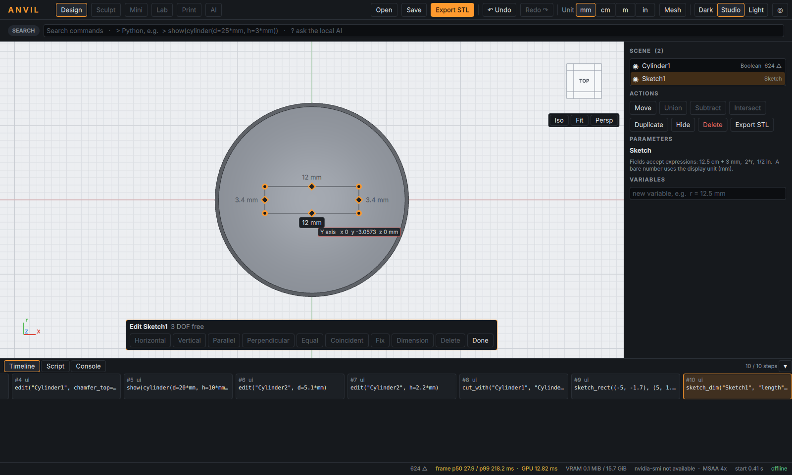
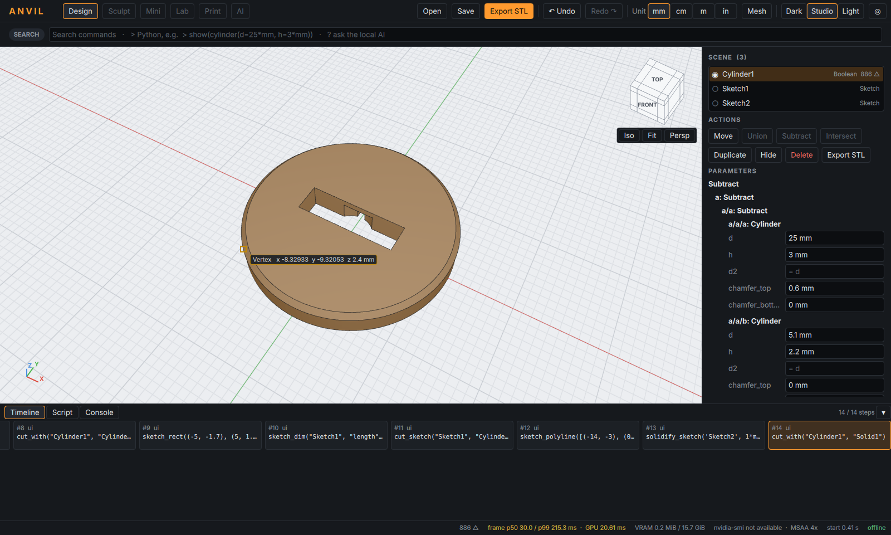
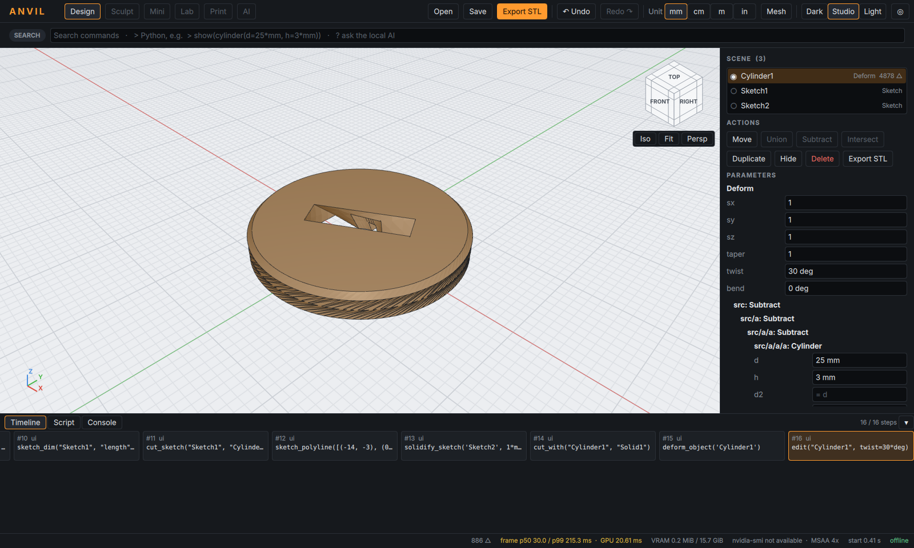

# ANVIL M2 – Kurzanleitung: Zeichnen, Abziehen, Verformen, exakte Features

Bauen wie in M1 (`scripts\build-windows.ps1`). Der erste Build kompiliert
OpenCASCADE 8.0.1 aus dem Quelltext (einmalig, ca. 30–60 min); danach baut
nur noch ANVIL selbst.

## 1. Zeichnen – ohne Skizziermodus

Rechte Maustaste halten (oder Leertaste) über leerem Raum öffnet das Radial:

| Richtung | Werkzeug |
|---|---|
| oben (N) | **Polylinie** |
| oben links (NW) | **Rechteck** |
| links (W) | **Kreis** |

- **Der erste Klick bestimmt die Zeichenebene:** auf eine ebene Fläche eines
  Teils (Ober-, Seiten-, Vorderfläche) → dort; ins Leere → Boden (z = 0).
- Punkte rasten an Ecken, Mitten, Achsen, am Raster und **waagrecht/senkrecht**
  zum vorigen Punkt ein (Anzeige „horizontal“/„vertical“). **Alt** schaltet das
  Einrasten ab.
- **Länge tippen:** einfach Zahl eingeben (`12`, `3.5 cm`) und Enter – der
  nächste Punkt liegt genau so weit in Cursor-Richtung.
- Polylinie: Klick auf den Startpunkt schließt sie; **Doppelklick, Enter oder
  „Finish“** beendet eine offene Linie; **Rücktaste** nimmt den letzten Punkt
  zurück; **Esc** bricht ab.

Fertig gezeichnet → genau **ein** Befehl, z. B.
`sketch_rect((-5, -1.7), (5, 1.7), plane="XY", offset=3*mm, name="Sketch1")`.
Die neue Skizze ist gewählt; unten erscheint die Schnellleiste:

**Extrude · Solidify · Cut through ‹Teil› · Revolve · Edit**

(gleiche Befehle im Radial, wenn eine Skizze gewählt ist).



## 2. Maße und Bedingungen (Edit)

- **Länge anklicken, Wert tippen, Enter** → Bemaßung (`sketch_dim`). Bemaßte
  Werte bleiben anklickbar und können auch Ausdrücke sein (`2*w`).
- **Punkte ziehen:** der Solver hält alle Bedingungen ein und bewegt nur, was
  nötig ist.
- Linien (◆) und Punkte (●) anklicken zum Auswählen, dann Leiste:
  Horizontal, Vertikal, Parallel, Senkrecht, Gleich, Deckungsgleich, Fixieren,
  Bemaßung, Löschen. Grün umrandete Punkte sind vollständig bestimmt; die
  Leiste zeigt die verbleibenden Freiheitsgrade und benennt Konflikte.

## 3. Abziehen – z. B. Lithografiemaske

**Variante A – auf dem Teil zeichnen:** Rechteck/Polylinie auf die Fläche
zeichnen → **Cut through ‹Teil›** (ein Klick). ANVIL weiß, auf welchem Teil
die Skizze entstand. Für Gräben statt Durchbrüchen im Skript:
`cut_sketch("Sketch1", "Teil", depth=0.2*mm, mode="solidify", width=0.5*mm)`.

**Variante B – Werkzeugkörper:** Polylinie zeichnen → **Solidify** (Bahn mit
Breite/Höhe) → Teil wählen → Radial **N: „Cut with…“** → Werkzeuge im
Viewport anklicken → **Enter**. Mit zwei bereits gewählten Objekten zieht
„Cut with…“ sofort ab (erstes minus Rest).



Exakte Teile (verrundet, gefast) lassen sich mit Solidify-/Deform-Körpern
kombinieren. Eine Verrundung **auf** einem Solidify-/Deform-Ergebnis ist nicht
möglich; ANVIL sagt dann genau, warum und in welcher Reihenfolge es geht.

## 4. Verformen und Werte ziehen

Teil wählen → Radial **NW: „Deform“** → im Panel: `sx sy sz` (Strecken),
`taper` (Verjüngung oben), `twist` (Verdrillung), `bend` (Biegung).

**Jeder Parametername im Panel ist ein Schieber:** Namen nach links/rechts
ziehen, das Teil folgt als Vorschau, Loslassen = ein Befehl, ein Undo-Schritt
(z. B. `edit("Cylinder1", twist=30*deg)`). **Umschalt** beim Ziehen = fein.



## 5. Exakte Features und STEP

Im Radial unter **Edit ▸**: Round edges (Fillet), Shell, Chamfer; Radius bzw.
Dicke im Panel (auch per Ziehen). Kantenauswahl im Skript:
`fillet_object("Teil", 1*mm, edges="vertical")` (`all`, `top`, `bottom`,
`vertical`, `horizontal`, `near:x,y,z`). STEP-Import über
**More ▸ Import STEP…**, Export über die Befehlsleiste („Export STEP“).

Die Berechnung läuft im eigenen Prozess `anvil-geom`; stürzt OpenCASCADE ab,
startet er neu, das Dokument bleibt erhalten.

## 6. Skript

Alles oben ist Python; die Zeitleiste zeigt die erzeugten Befehle. Beispiel
Maske in vier Zeilen:

```python
show(box(x=40*mm, y=30*mm, z=1*mm), name="Mask")
sketch_polyline([(-15, -10), (-5, -10), (-5, 5), (10, 5)], offset=1*mm, name="Trace")
cut_sketch("Trace", "Mask", depth=0.2*mm, mode="solidify", width=0.5*mm)
export_stl("Mask", "mask.stl")
```
