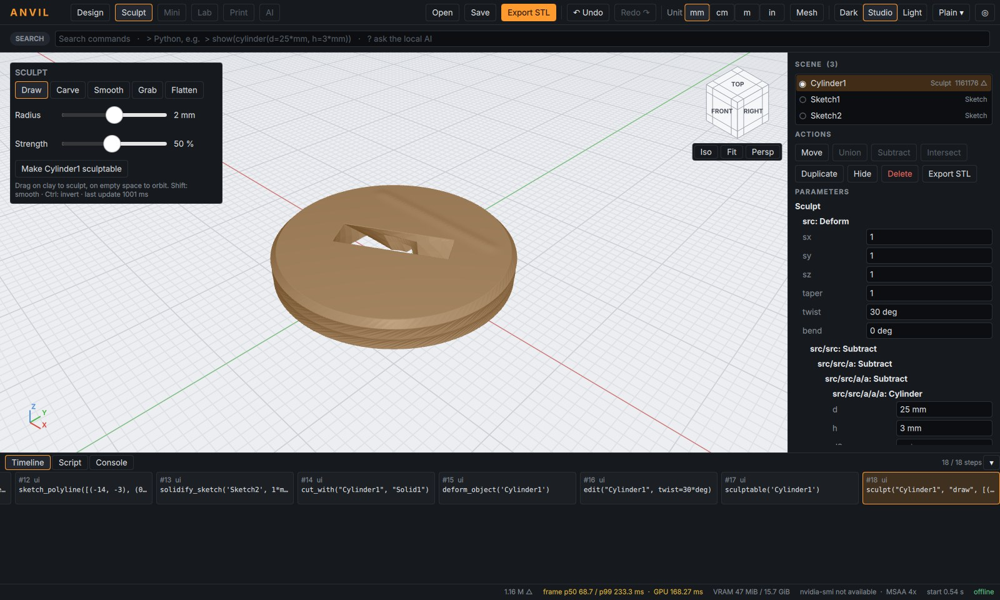

# ANVIL M3 – Kurzanleitung: Modellieren wie mit Ton (Sculpting)

## 1. Losmodellieren in drei Klicks

1. Oben **Sculpt** wählen.
2. Ein Objekt anklicken → im Sculpt-Feld links **„Make … sculptable“**
   (oder Radial, Richtung SW). Das Objekt wird zu „Ton“ mit 0,05 mm Voxeln;
   große Objekte bekommen automatisch gröbere Voxel. Die ursprüngliche Form
   bleibt als parametrische Quelle im Baum erhalten. Die Umwandlung dauert je
   nach Größe einige Sekunden.
3. **Auf dem Objekt ziehen = modellieren, daneben ziehen = Ansicht drehen.**

| Pinsel | Wirkung |
|---|---|
| Draw | Material entlang der Oberflächennormale aufbauen |
| Carve | eingraben |
| Clay | flache Schichten aufbauen – das Arbeitspferd für Formen |
| Inflate | entlang der lokalen Normale aufblähen/schrumpfen |
| Crease | scharfe Rillen: Falten, Lider, Stoff |
| Pinch | Grate und Kanten schärfen |
| Smooth | glätten (auch: **Umschalt** halten) |
| Grab | Oberfläche mit dem Zeiger mitziehen |
| Flatten | auf die Ebene des ersten Berührpunkts abflachen |

**Einstellungen:** Größe (0,2–20 mm), Intensität (bei 100 % hebt ein Strich
die Fläche um etwa die halbe Pinselgröße), Falloff (weich ↔ scharf),
**Spiegeln X/Y/Z** (um die Objektmitte – für Figuren meist X), **Invert**
(oder **Strg** halten). **Detail:** „Finer“/„Coarser“ tastet den Ton neu ab
(halbe/doppelte Voxelgröße).

Ein normales Teil im Sculpt-Modus anklicken wandelt es in Ton um; während
der Umwandlung zeigt das Feld „Preparing clay…“. Radial im Sculpt-Modus:
Draw, Clay, Smooth, Grab, Carve, weitere Pinsel (▸), View.



## 2. Ein Strich = ein Befehl

Jeder Strich steht als **ein** Eintrag in der Zeitleiste, z. B.
`sculpt("Kopf", "draw", [(…), (…)], radius=2*mm, strength=0.5)`, und ist ein
Undo-Schritt. Gespeicherte Dateien enthalten die Striche; das Laden ergibt
bitgenau dasselbe Modell.

## 3. Kombinieren und drucken

Ton-Objekte lassen sich mit allem anderen kombinieren, z. B. eine exakte
Bohrung oder ein Magnetloch abziehen (Design-Modus, „Cut with…“). Der Export
prüft wie immer das Netz; modellierte Flächen sind geschlossen und
schnittfrei. Scharfe Kanten des Ausgangskörpers werden beim Umwandeln um
höchstens eine Voxelbreite gebrochen; exakte Kanten setzt man danach mit
CAD-Körpern.

## 4. Skript

```python
show(sphere(d=20*mm), name="Kopf")
sculptable("Kopf", voxel=0.1*mm)
sculpt("Kopf", "draw", [(-3, 0, 10), (0, 1, 10), (3, 0, 10)], radius=3*mm, strength=0.8)
sculpt("Kopf", "smooth", [(-3, 0, 10), (3, 0, 10)], radius=3*mm, strength=1.0)
subtract("Kopf", cylinder(d=5.1*mm, h=2.2*mm).translate(z=-10*mm))
export_stl("Kopf", "kopf.stl")
```

## 5. Mehr Grundformen (Design-Modus)

Radial über leerem Raum → **Shapes ▸**: Kugel, Rohr, Kegel, Sechskant-Prisma,
Torus, Kapsel, abgerundeter Quader, **More ▸** (Pyramide, Keil, Ellipsoid,
Stern, STL-/STEP-Import). Alle sind parametrisch: Werte im Panel tippen oder
am Namen ziehen.

| Befehl | Form |
|---|---|
| `tube(d, d_in, h)` | Rohr / Ring / Hülse |
| `prism(n, d, h)` | regelmäßiges n-Eck-Prisma (n = 6: Sechskant), d über Ecken |
| `pyramid(n, d, h)` | Pyramide mit n-eckiger Grundfläche |
| `capsule(d, h)` | Zylinder mit Halbkugel-Enden |
| `rounded_box(x, y, z, r)` | Quader mit Radius r an allen Kanten |
| `wedge(x, y, z)` | Keil / Rampe |
| `ellipsoid(x, y, z)` | Ellipsoid (Durchmesser) |
| `star(n, d, d_in, h)` | Sternprisma |
