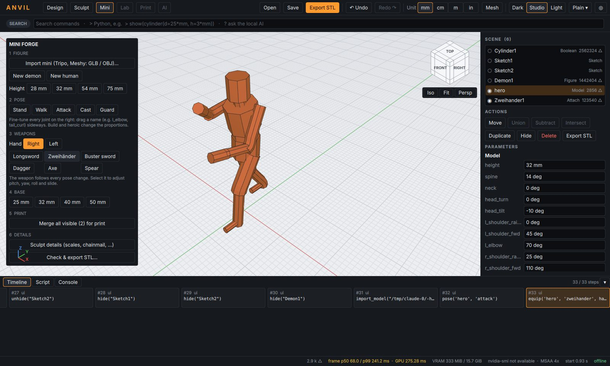
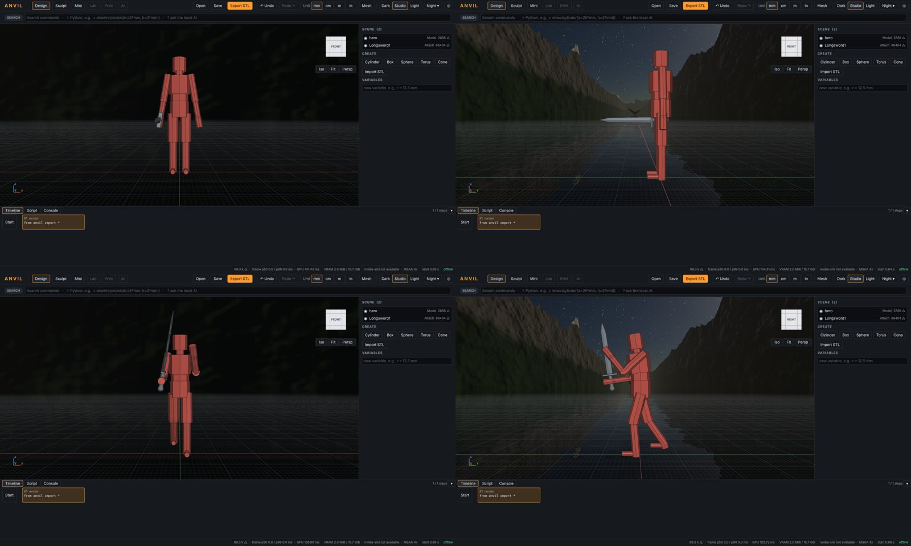
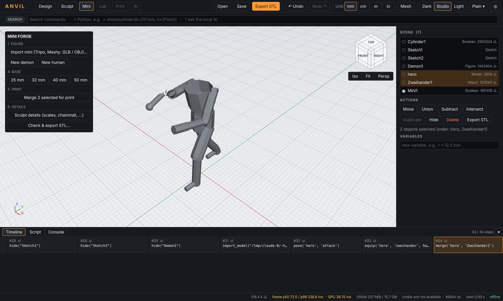

# ANVIL M4 – Kurzanleitung: Minis aus Tripo/Meshy posen, bewaffnen, drucken

## 1. Mini importieren

1. In Tripo oder Meshy das Modell **als GLB exportieren** – am besten
   **mit Rig** (Tripo „Rig“, Meshy „Rigging“; T- oder A-Pose). OBJ und STL
   gehen auch, dann setzt ANVIL ein eigenes Skelett.
2. Oben **Mini** wählen → **„Import mini (Tripo, Meshy: GLB / OBJ)…“**
   oder die Datei einfach ins Fenster ziehen.
3. Das Modell ist 32 mm hoch, steht auf der Bodenplatte (z = 0) und schaut
   nach vorne (−Y). Die Arme hängen in der Grundstellung – auch wenn die Datei
   in T-Pose war. Höhe ändern: Knöpfe 28/32/54/75 mm oder rechts `height`.

Nicht unterstützt: FBX (in Blender/Tripo als GLB exportieren) und
Draco-komprimierte GLB (Kompression beim Export abschalten). ANVIL nennt
den Grund jeweils in der Fehlermeldung.

### Ohne Rig: „Import as is“

**Mini → „Import as is (STL / OBJ / GLB, no rig)…“** (auch Befehl *Import mesh as is*, Radial
*Shapes ▸ More ▸*) lädt die Datei **genau so, wie sie ist**: kein Skelett, keine automatische
Pose, keine Verformung. Position und Größe wie in der Datei (glTF in Metern → mm, also 1,8 m →
1800 mm). Mit den Höhen-Knöpfen (28/32/54/75 mm) oder `fit_height("Name", 32*mm)` wird nur
gleichmäßig skaliert. Zum Drucken mit einem Sockel verschmelzen („Merge … for print“) – das
schließt Löcher des KI-Netzes.

```python
held = import_plain("C:/Minis/statue.glb", height=32*mm)
```

## 2. Posen

- **Stand, Walk, Attack, Cast, Guard** setzen alle Gelenkwinkel auf einmal.
- Feinarbeit rechts im Panel: Namen wie `r_shoulder_fwd`, `l_elbow`,
  `spine`, `head_turn`, `l_knee` seitlich ziehen oder Werte tippen.
- Jede Änderung ist **ein** Undo-Schritt. Hat die Datei ein Rig, werden
  dessen Knochen verwendet; sonst ein automatisches 17-Gelenk-Skelett.



## 3. Waffen in die Hand

Mini auswählen → **Hand: Right/Left** → **Longsword, Zweihänder, Buster
sword, Dagger, Axe, Spear**. Die Waffe sitzt in der Faust und **folgt jeder
Posenänderung**. Waffe auswählen, dann rechts:

| Parameter | Wirkung |
|---|---|
| `pitch` | Klinge hoch (+) / runter (−) |
| `yaw` | seitlich schwenken |
| `roll` | um die eigene Achse drehen |
| `slide` | Hand am Griff verschieben |

Länge, Breite, Dicke, Griffdurchmesser stehen im Waffenobjekt (Pfad `item`).
Die Standardmaße sind für 32-mm-Figuren gewählt und druckbar (Klinge ≥ 0,5 mm).



## 4. Verschmelzen und drucken

- **Basis:** 25/32/40/50 mm unter „BASE“.
- **„Merge … for print“**: verschmilzt die ausgewählten Teile (oder alle
  sichtbaren) zu **einem** geschlossenen Objekt – Löcher, sich durchdringende
  Teile und Falten des KI-Netzes werden dabei repariert, Hohlräume gefüllt.
  Die Teile bleiben verknüpft: Pose oder Waffe ändern → das Merge-Objekt
  folgt. Dauer: einige Sekunden.
- Danach wie gewohnt **Sculpt** (Details, Schuppen, Kettenhemd) und
  **Check & export STL**.



Weitere Teile aus Tripo (z. B. ein separat erzeugtes Schwert oder ein Schild)
ebenfalls importieren, mit **Move** platzieren und mit verschmelzen.

## 5. Skript

```python
held = import_model("C:/Minis/paladin.glb", height=32*mm)
pose(held, "attack")
edit(held, r_elbow=60*deg)
schwert = equip(held, "zweihander", hand="r", pitch=20*deg)
basis = show(mini_base(d=25*mm), name="Basis")
mini = merge(held, schwert, basis, name="Paladin")
export_stl(mini, "paladin.stl")
```
