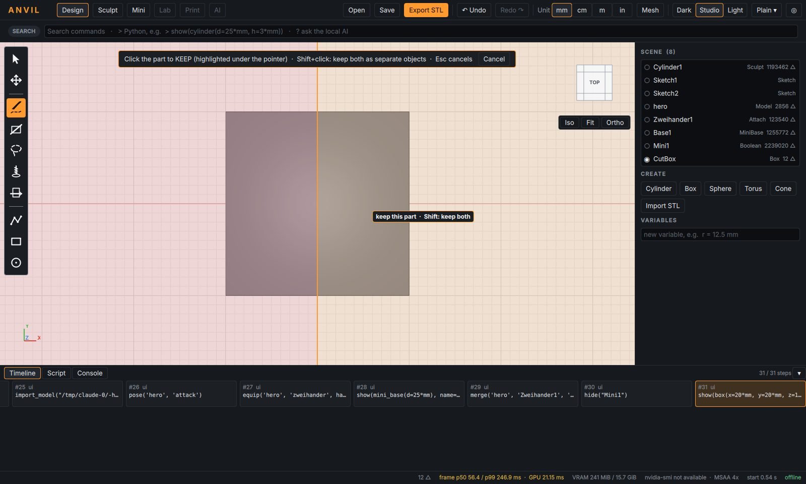
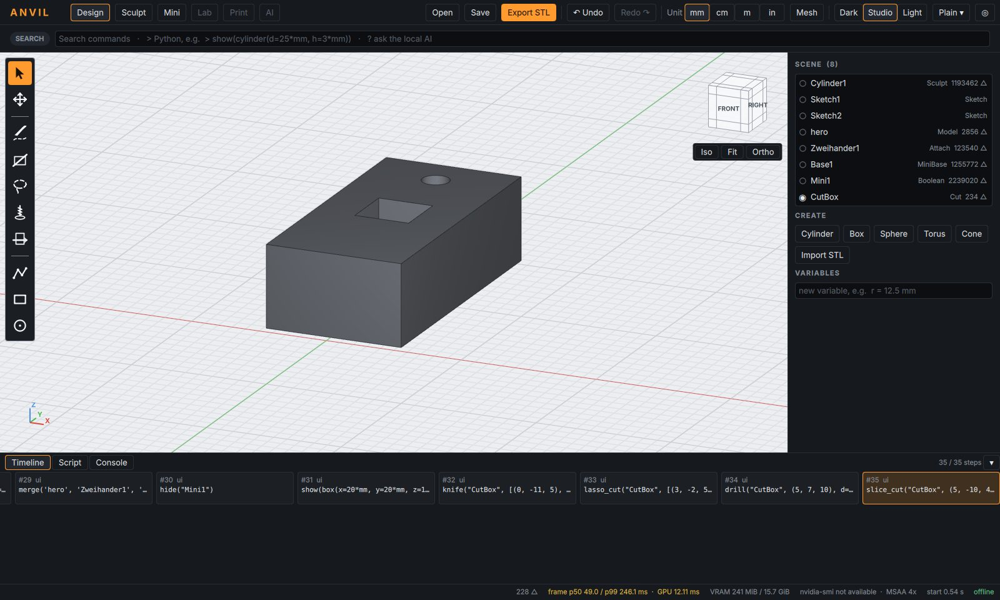
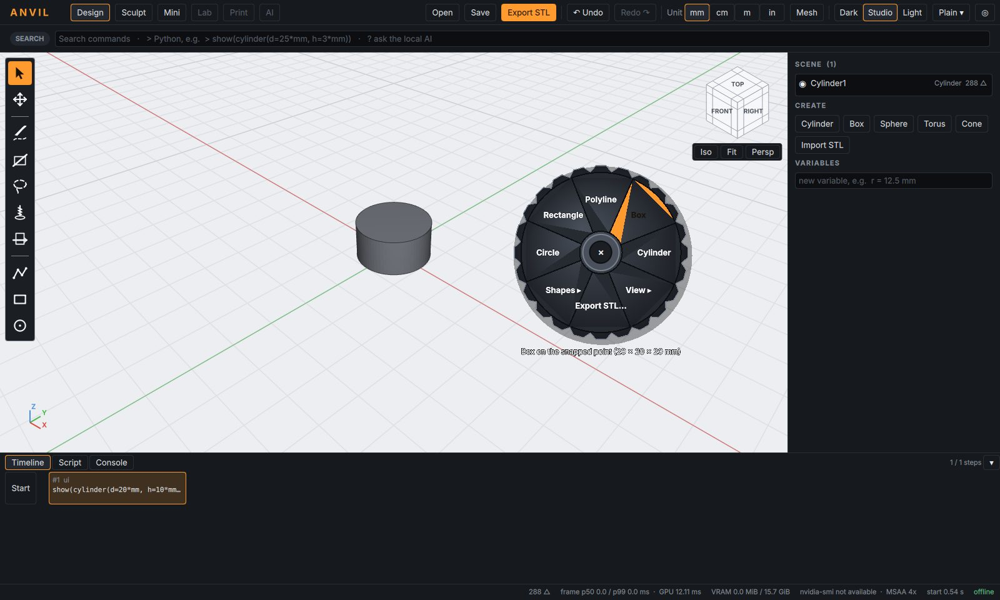

# ANVIL – Werkzeugleiste, Schnitt-Werkzeuge, Radialmenü, Speicher

## 1. Werkzeugleiste (links)

Von oben nach unten: **Auswahl**, **Verschieben**, dann die Schnitt-Werkzeuge
**Messer**, **Gerader Schnitt**, **Lasso**, **Bohrer**, **Scheibe**, darunter
die Skizzen-Werkzeuge **Polylinie**, **Rechteck**, **Kreis**. Das aktive
Werkzeug leuchtet orange; **Esc** kehrt zur Auswahl zurück. Jeder Schnitt ist
**ein** Befehl in der Zeitleiste und ein Undo-Schritt.

| Werkzeug | Bedienung |
|---|---|
| Messer | Punkte quer über das Objekt klicken, **Enter** oder Doppelklick beendet, **Rücktaste** nimmt den letzten Punkt zurück |
| Gerader Schnitt | zwei Klicks |
| Lasso | Schleife ziehen (Maustaste gedrückt halten) |
| Bohrer | auf die Stelle klicken – rundes Loch geradewegs hindurch, entlang der Blickrichtung; Durchmesser im Feld neben der Leiste |
| Scheibe | auf die Höhe klicken – waagerechter Schnitt (z. B. flacher Boden einer Mini) |

**Welcher Teil bleibt?** Nach dem Zeichnen zeigt ANVIL die beiden Seiten:
die Seite unter dem Mauszeiger ist **orange (bleibt)**, die andere **rot
(fällt weg)**. Klicken behält die orange Seite; **Umschalt+Klick behält beide**
als getrennte Objekte. Der Schnitt geht durch das ganze Objekt, die
Schnittfläche wird geschlossen – das Ergebnis ist sofort druckbar.

In der Perspektive folgt der Schnitt den Sehstrahlen der Kamera: er trifft
auf jeder Tiefe genau die gezeichnete Linie. Ohne Auswahl werden alle Objekte
geschnitten, über die die Linie läuft; mit Auswahl nur die ausgewählten.
Ton (Sculpt) und importierte Minis werden ebenso geschnitten.




Skript:
```python
knife("Teil", [(0, -30, 5), (0, 30, 5)], direction=(0, 0, -1), keep="left")   # "both" = beide Teile
lasso_cut("Teil", [(-2, -2, 10), (2, -2, 10), (2, 2, 10), (-2, 2, 10)], keep="outside")
drill("Teil", (0, 7, 10), d=2*mm)
slice_cut("Mini", (0, 0, 0.4))            # flacher Boden bei z = 0,4 mm
```

## 2. Sculpt: Regler mit Zahlenfeld

Größe, Intensität, Falloff und (Textur) Zellgröße haben neben dem Regler ein
Eingabefeld: Wert tippen und **Enter**. Längen in der Dokumenteinheit oder mit
Einheit („1,5“, „1.5 mm“, „0.05 in“), Intensität in Prozent.

## 3. Radialmenü als Zahnrad

Das Radialmenü ist jetzt ein undurchsichtiges Stahl-Zahnrad mit heller,
umrandeter Schrift – auf hellem und dunklem Hintergrund gleich gut lesbar.
Bedienung unverändert (Leertaste oder rechte Maustaste halten, Richtung,
loslassen).



## 4. Speicher

Die Statusleiste zeigt den Arbeitsspeicher von ANVIL („RAM …“). Zwischen-
ergebnisse (Netze, Ton-Gitter) werden zwischengespeichert, aber nur bis zu
festen Obergrenzen (1 GiB Formen, 512 MiB Ton-Teilnetze, 512 MiB Sculpt-
Zwischenstände); Älteres wird verworfen und bei Bedarf neu berechnet.
**Klick auf „RAM“** (oder Befehl „Free memory“) leert die Zwischenspeicher
sofort; Dokument und Undo bleiben erhalten.

Messung (Linux, 400 k-Dreiecks-Mini, 5× neu posen + verschmelzen): Spitze
1,98 → 1,52 GB, Dauerzustand 1,53 → 1,15 GB, nach „Free memory“ 0,23 GB.
Bisher wuchs der Verbrauch mit jeder Änderung weiter.

## 5. Mini-Panel

Die eingebauten Figuren (Mensch/Dämon) sind entfernt; Minis kommen per Import
(GLB/OBJ von Tripo, Meshy, Blender). Ältere Dokumente mit `figure(...)`
lassen sich weiterhin öffnen.
